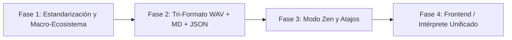

# 📋 Bitácora de Desarrollo y Hoja de Ruta (Roadmap)
## Proyecto: Traductor de Audio en Tiempo Real (Subtítulos Bilingües y Captura WASAPI)

Esta bitácora documenta el diagnóstico técnico, la arquitectura, las deudas detectadas, el plan de evolución y el registro histórico de versiones del **Traductor de Audio en Tiempo Real**, componente del **Macro-Sistema de IA Local**.

---

## 🧭 1. Visión y Diagnóstico de Arquitectura (v1.0.0)

El proyecto captura el audio reproducido por el ordenador en Windows (reuniones de Microsoft Teams, Zoom, Google Meet, vídeos de YouTube, cursos técnicos o llamadas) mediante **WASAPI Loopback**, reconoce el habla en inglés en tiempo real con **Faster-Whisper (INT8)**, traduce a español con **CTranslate2**, e inyecta **subtítulos cinematográficos flotantes y bilingües** de alta legibilidad sobre cualquier ventana activa.

### Fortalezas Clave
- **100% Local y Confidencial:** No requiere tokens, APIs ni servicios en la nube.
- **Captura Directa de Hardware (WASAPI Loopback):** Escucha lo que sale por los auriculares o altavoces sin requerir Virtual Audio Cable ni cables físicos.
- **Diarización Acústica Integrada (`speaker_engine.py`):** Diferencia a los distintos participantes de la llamada por tono y características espectrales.
- **Subtítulos Bilingües Cinematográficos:** Diseño traslúcido tipo cine con alineación par a par (Español destacado arriba, Inglés de referencia pegado abajo) para aprendizaje y comprensión inmediata.
- **Control de Instancia Única:** Named Pipe `TraductorAudio_SingleInstance_2026`.

---

## 🔍 2. Deudas Técnicas y Oportunidades de Mejora

| ID | Área | Descripción de la Oportunidad / Deuda | Prioridad |
|---|---|---|---|
| **DT-TA01** | **Ecosistema Tri-Formato** | Actualmente guarda solo en `.txt`. Debe incorporar el estándar sincronizado `.wav` (audio raw) + `.md` (minuta bilingüe) + `.json` (timeline para frontend). | **Alta** |
| **DT-TA02** | **Modo Cápsula Zen** | En momentos donde solo se desea registrar la sesión sin ver subtítulos en pantalla, implementar un modo colapsable mínimo similar al Asistente de Reunión. | **Media** |
| **DT-TA03** | **Captura Dual de Micrófono** | Extender opcionalmente la captura al micrófono del usuario (modo bidireccional) como lo hace `10_Asistente-de-reunion`. | **Media** |
| **DT-TA04** | **Aceleración GPU Opcional** | Permitir conmutación a CUDA/DirectML si el usuario dispone de GPU NVIDIA dedicada para modelos más grandes (`small.en` o `base.en`). | **Baja** |

---

## 🗺️ 3. Plan de Trabajo y Fases de Evolución

### 🔹 Fase 1: Estandarización y Macro-Ecosistema (En Progreso)
- [x] Migración de rama principal a `main` y control de versiones profesional.
- [x] Documentación exhaustiva técnica y de flujo en `doc/`.
- [x] Bitácora técnica y registro de arquitectura macro.
- [x] Verificación de pruebas automatizadas del pipeline de audio y traducción.

### 🔹 Fase 2: Protocolo Tri-Formato Sincronizado
- [ ] Integración del módulo de grabación continua `AudioRecorder` a `.wav` (16 kHz mono).
- [ ] Generación simultánea de transcripción en **Markdown (`.md`)** bilingüe con Frontmatter YAML y tablas de vocabulario.
- [ ] Generación de **Timeline JSON (`.json`)** con timestamps relativos al audio `{start_sec, end_sec, en_text, es_text, speaker}` para el frontend interactivo.

### 🔹 Fase 3: Modo Zen y Atajos de Teclado
- [ ] Incorporación del widget de onda de audio reactiva para supervisión silenciosa.
- [ ] Atajo de teclado global para ocultar/mostrar subtítulos rápidamente (`Ctrl+Shift+S`).
- [ ] Selector rápido de dispositivo de audio de entrada directo desde el menú.

### 🔹 Fase 4: Integración en el Dashboard / Intérprete Unificado
- [ ] Conexión de sesiones de subtítulos con el frontend común de la suite para reproducir el audio con *click-to-seek* bilingüe.

---

## 📝 4. Registro Histórico de Cambios (Changelog)

Formato basado en [Keep a Changelog](https://keepachangelog.com/es-ES/1.0.0/) y versionado semántico.

### [1.1.0] - 2026-11-19
#### Añadido
- **Alineación con la Macro Suite de IA:** Renombramiento de rama principal a `main`.
- **Suite de Documentación Técnica:** Incorporación de la carpeta `doc/` con arquitectura, flujo de audio, protocolo IPC y manual de usuario.
- **Bitácora Formal:** Creación de `BITACORA.md` con mapa de dependencias y roadmap para el protocolo tri-formato.
- **Estandarización de .gitignore:** Reglas actualizadas para futuros archivos `.wav`, `.md` y `.json`.

### [1.0.0] - 2026-11-13
#### Añadido
- Captura WASAPI Loopback en tiempo real para sonido del PC.
- Motor de transcripción Whisper `tiny.en` cuantizado INT8 con Silero VAD.
- Motor de traducción neuronal CTranslate2 (Inglés a Español).
- Diarización acústica en CPU para diferenciar interlocutores.
- Ventana de subtítulos flotantes de alta legibilidad con auto-ajuste y arrastre.
- Modos de visualización: Bilingüe (Español arriba, Inglés abajo), Solo Español, Solo Inglés.
- Registro automático de sesiones en `transcripciones/*.txt`.
- Sockets locales `TraductorAudio_SingleInstance_2026` y ejecutor silencioso `iniciar.vbs`.
