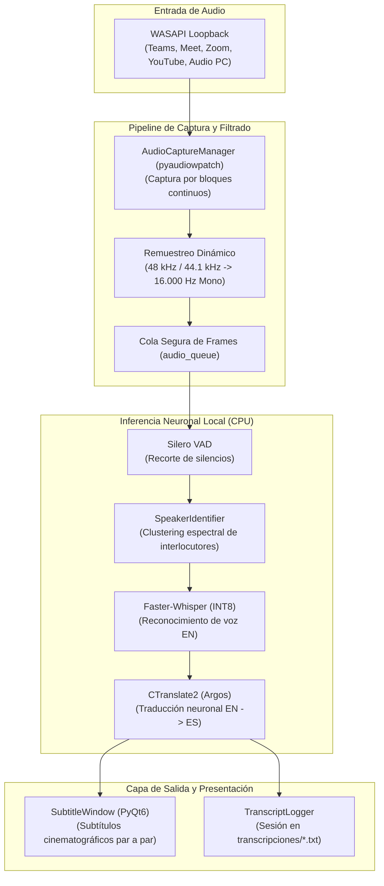

# 🏗️ 01. Arquitectura y Flujo de Procesamiento

Este documento describe la arquitectura modular del **Traductor de Audio en Tiempo Real** y el flujo de los paquetes de sonido desde la tarjeta de audio hasta la proyección visual de los subtítulos.

---

## 🧭 Diagrama de Flujo

---

## 🧩 Módulos Principales

### 1. `AudioCaptureManager` (`audio_capture.py`)
- Emplea `pyaudiowpatch` para acceder al dispositivo predeterminado de renderizado de Windows mediante **WASAPI Loopback**.
- Incluye un mecanismo de "Keep-Alive" que inyecta tramas imperceptibles para evitar que el reloj WASAPI se suspenda en silencios prolongados.
- Realiza el remuestreo de la señal a **16.000 Hz mono con float32 normalizado**, formato requerido por los modelos Whisper.

### 2. `LiveTranscriber` (`transcriber_engine.py`)
- Filtra tramas vacías mediante Silero VAD para no sobrecargar el procesador cuando nadie habla.
- Ejecuta Faster-Whisper cuantizado en INT8.
- Maneja un buffer deslizante con solapamiento (*overlap*) para no cortar palabras en los límites de los bloques de audio.

### 3. `SpeakerIdentifier` (`speaker_engine.py`)
- Analiza la señal acústica de cada frase identificando formantes y frecuencia fundamental (F0).
- Agrupa las intervenciones en clusters para etiquetar coherentemente a `Hablante 1`, `Hablante 2`, etc.

### 4. `LocalTranslator` (`translator_engine.py`)
- Infiere la traducción del texto en inglés al español mediante modelos CTranslate2 optimizados en CPU.
- Procesa oraciones en menos de 30 milisegundos.

### 5. `SubtitleWindow` (`subtitle_window.py`)
- Ventana sin bordes (*frameless*), siempre al frente (*WindowStaysOnTopHint*), con fondo negro translúcido y esquinas redondeadas.
- Soporta 3 modos de visualización:
  - **Bilingüe:** Español arriba en tamaño grande destacado + Inglés abajo en tono secundario.
  - **Solo Español:** Para visualización limpia y mínima.
  - **Solo Inglés:** Para entrenamiento de comprensión auditiva directa.
