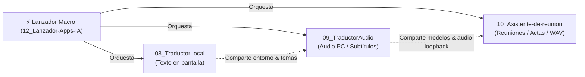

# 🌐 04. Integración en el Macro-Sistema de IA

Este documento detalla la integración técnica de **Traductor de Audio en Tiempo Real** dentro de la suite completa y la interoperabilidad con las herramientas hermanas.

---

## 🏛️ Sinergia de la Suite Macro

La suite integra tres herramientas de IA complementarias organizadas bajo el orquestador flotante:

---

## 🔗 Pilares de Interoperabilidad

### 1. Entorno Virtual Unificado (`.audio_translator_venv`)
`09_TraductorAudio` comparte el entorno de ejecución ubicado en:
`C:\Users\%USERNAME%\.audio_translator_venv`
Contiene todas las dependencias compartidas (`PyQt6`, `faster-whisper`, `ctranslate2`, `pyaudiowpatch`, `scipy`, `numpy`), evitando redundancia en disco y acelerando el tiempo de arranque.

### 2. Canales IPC Estandarizados
El lanzador supervisa la actividad de `TraductorAudio_SingleInstance_2026` mediante un socket de sondeo cada 2 segundos, iluminando el punto verde `●` en el panel flotante y permitiendo traer la barra de subtítulos al frente con un solo clic.

### 3. Conexión con el Asistente de Reunión (`10_Asistente-de-reunion`)
- `09_TraductorAudio` está enfocado en **subtitulación visual en tiempo real de inglés a español** para conferencias, cursos o llamadas unilaterales.
- `10_Asistente-de-reunion` está enfocado en **captura bidireccional (PC + Micrófono), resumen de compromisos y minutas ejecutivas**.
- Ambos comparten la misma tecnología base de captura WASAPI y Whisper cuantizado, lo que permite reutilizar mejoras de latencia o calibración de hardware entre ambos proyectos.

### 4. Preparación para el Frontend / Intérprete Unificado
Al adoptar el estándar de datos tri-formato (`.wav` + `.md` + `.json`), una futura aplicación frontend podrá leer tanto las sesiones del Asistente de Reunión como las grabaciones del Traductor de Audio desde una sola biblioteca visual con buscador, reproductor con forma de onda interactiva y exportador de minutas.
